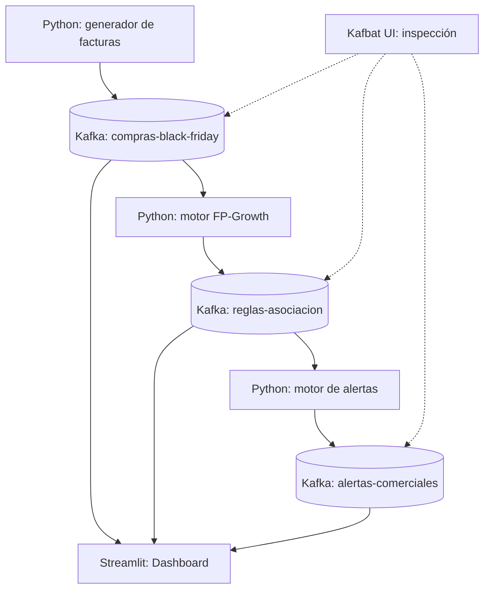

# 🛒 Black Friday Intelligence

**Demostración de analítica de datos en tiempo real con Apache Kafka, Python, FP-Growth, Kafbat UI y Streamlit.**

   

## 📌 Descripción

Black Friday Intelligence simula compras en una tienda para demostrar cómo **Apache Kafka desacopla la captura de eventos de su análisis**. Un productor genera facturas con varios productos; un consumidor aplica el algoritmo **FP-Growth**; otro transforma patrones seleccionados en **alertas comerciales**; y un dashboard muestra los resultados.

**Proyecto académico:** todos los datos son sintéticos. Los patrones descubiertos no reflejan comportamiento real de clientes.

## 🎯 Objetivos

- Demostrar productores, consumidores, topics, particiones y offsets en Kafka.
- Observar el funcionamiento asíncrono y el *consumer lag* mediante Kafbat.
- Analizar canastas de compra mediante **FP-Growth**.
- Interpretar **soporte, confianza y lift**.
- Transformar hallazgos en alertas para posibles estrategias de venta cruzada.
- Visualizar transacciones y resultados en Streamlit.

## 🏗️ Arquitectura del sistema



Kafka **almacena y entrega eventos**, mientras que el análisis estadístico se realiza en Python. Los motores no necesitan comunicarse entre sí directamente: intercambian eventos a través de Kafka.

| Topic | Productor | Consumidores | Contenido |
|---|---|---|---|
| `compras-black-friday` | `productor_compras.py` | `motor_reglas.py`, dashboard | Facturas con listas de productos |
| `reglas-asociacion` | `motor_reglas.py` | `motor_alertas.py`, dashboard | Resultados periódicos de FP-Growth |
| `alertas-comerciales` | `motor_alertas.py` | Dashboard | Recomendaciones comerciales |

En la demostración, cada topic tiene **1 partición** y **factor de replicación 1**. Esta configuración simplifica el laboratorio, pero no proporciona alta disponibilidad.

## 🧰 Tecnologías

| Herramienta | Función |
|---|---|
| Apache Kafka 4.3.1 (KRaft) | Broker y almacenamiento de eventos |
| Docker Compose | Kafka y Kafbat en contenedores |
| Kafbat UI | Exploración de topics, mensajes y grupos consumidores |
| Python + `confluent-kafka` | Productores y consumidores |
| `pandas` + `mlxtend` | Codificación de canastas, FP-Growth y reglas |
| Streamlit | Dashboard de analítica |

## 🚀 Instalación y ejecución local

### Requisitos

- Docker Desktop con Docker Compose.
- Python 3 instalado.
- Puertos **9092**, **8081** y **8501** libres.
- PowerShell (comandos de ejemplo para Windows).

### 1. Clonar el repositorio

```powershell
git clone https://github.com/sara-munoz-5/kafka-black-friday.git
cd kafka-black-friday
```

### 2. Instalar las librerías

```powershell
python -m venv .venv
.\.venv\Scripts\python.exe -m pip install --upgrade pip
.\.venv\Scripts\python.exe -m pip install confluent-kafka pandas mlxtend streamlit
```

Los siguientes comandos usan `python`. Si no activas el entorno virtual, sustituye `python` por `.\.venv\Scripts\python.exe`.

### 3. Levantar Kafka y Kafbat

```powershell
docker compose up -d
docker compose ps
```

- **Kafka desde Windows:** `localhost:9092`
- **Kafbat UI:** http://localhost:8081
- **Kafka desde Kafbat (red Docker):** `kafka-lab:19092`

El archivo `docker-compose.yml` monta un volumen `kafka_lab_data` para persistir registros entre reinicios normales. La configuración usa PLAINTEXT y es **solo para laboratorio local**.

### 4. Crear los topics

En **Kafbat → Topics → Create Topic**, crear los siguientes tres topics con **1 partición** y **replication factor = 1**:

- `compras-black-friday`
- `reglas-asociacion`
- `alertas-comerciales`

O ejecutar:

```powershell
docker exec kafka-lab /opt/kafka/bin/kafka-topics.sh --bootstrap-server localhost:9092 --create --if-not-exists --topic compras-black-friday --partitions 1 --replication-factor 1
docker exec kafka-lab /opt/kafka/bin/kafka-topics.sh --bootstrap-server localhost:9092 --create --if-not-exists --topic reglas-asociacion --partitions 1 --replication-factor 1
docker exec kafka-lab /opt/kafka/bin/kafka-topics.sh --bootstrap-server localhost:9092 --create --if-not-exists --topic alertas-comerciales --partitions 1 --replication-factor 1
```

### 5. Iniciar los programas (cada uno en una terminal diferente)

**A. Generar facturas:**

```powershell
python productor_compras.py
```

**B. Analizar canastas con FP-Growth:**

```powershell
python motor_reglas.py
```

**C. Generar alertas comerciales:**

```powershell
python motor_alertas.py
```

**D. Ver el dashboard:**

```powershell
python -m streamlit run dashboard_intelligence.py
```

Abrir **http://localhost:8501** para visualizar el dashboard.

Para detener los scripts, usar `Ctrl + C`. Para detener los servicios sin borrar el volumen:

```powershell
docker compose down
```

> ⚠️ No uses `docker compose down -v` si quieres conservar los registros de Kafka: esa opción elimina los volúmenes de Compose.

## 🧾 Formato de las facturas

Cada evento es una transacción que puede contener varios productos:

```json
{
  "factura_id": "a82bc941",
  "fecha": "2026-10-20T10:30:00",
  "productos": ["Celular", "Audifonos"],
  "total": 1585000
}
```

Los valores anteriores son ilustrativos. `productor_compras.py` genera combinaciones aleatorias basadas en patrones de tecnología, alimentos y entretenimiento; envía aproximadamente una factura cada **0,5 segundos**. Se introducen variaciones para que no todas las canastas sean idénticas.

## 🧠 FP-Growth y reglas de asociación

`motor_reglas.py` recibe facturas de `compras-black-friday`, codifica la presencia de productos con `TransactionEncoder` y ejecuta **FP-Growth** sobre una **ventana móvil de hasta 200 facturas**. Publica un resultado después de cada **20 facturas consumidas**.

| Parámetro | Valor actual |
|---|---:|
| Ventana máxima | 200 facturas |
| Frecuencia de análisis | Cada 20 facturas |
| Soporte mínimo | 0,05 |
| Confianza mínima | 0,45 |
| Máximo tamaño del conjunto frecuente | 2 productos |
| Reglas emitidas por análisis | Hasta 10, ordenadas por lift |

### Interpretación de métricas

Para la regla **Celular → Audífonos**:

- **Soporte:** proporción de todas las facturas que incluyen ambos productos.
- **Confianza:** proporción de facturas con Celular que también tienen Audífonos.
- **Lift:** cuántas veces aparece esta asociación respecto a lo esperado si ambos productos fueran independientes.

**Ejemplo ilustrativo:** soporte **15 %**, confianza **75 %**, lift **3,00**. Esto describe asociación positiva, **no causalidad**. Los valores reales varían según las compras simuladas.

El algoritmo funciona aquí por **micro-lotes** sobre la ventana de transacciones, no de manera incremental en cada mensaje individual.

## 🔔 Alertas comerciales

`motor_alertas.py` consume `reglas-asociacion` y publica alertas en `alertas-comerciales` cuando se cumplen simultáneamente:

- Soporte ≥ **0,05**.
- Confianza ≥ **0,50**.
- Lift ≥ **1,20**.

Ejemplo: *«Evaluar una promoción de Audífonos para clientes que compran Celular»*.

El motor evita repetir la misma combinación de productos **durante una ejecución** mediante memoria local. Ese registro no persiste tras reiniciar el proceso.

## 📊 Dashboard Streamlit

`dashboard_intelligence.py` reúne cuatro vistas:

| Pestaña | Información |
|---|---|
| Ventas | Facturas, ingresos simulados, productos y compras recientes |
| Reglas de asociación | Soporte, confianza, lift y comparación visual |
| Alertas | Historial de recomendaciones publicadas |
| Eventos Kafka | Conteos de mensajes leídos por la sesión |

El dashboard usa un grupo consumidor independiente, se actualiza cada pocos segundos y calcula sus métricas en memoria. **El número de eventos mostrado no es el consumer lag del broker**; para medirlo se utiliza Kafbat.

## ⏯️ Prueba de asincronía (pendiente de validación en vivo)

**Objetivo:** demostrar que Kafka continúa recibiendo eventos aunque el motor de FP-Growth se detenga.

1. Mantener `productor_compras.py` ejecutándose.
2. Detener `motor_reglas.py` con `Ctrl + C`.
3. Abrir **Kafbat → Consumer Groups → `motor-fpgrowth-v1`** y observar sus offsets confirmados y el **lag**.
4. Mientras el motor está detenido, dejar que se generen nuevas facturas.
5. Volver a ejecutar `python motor_reglas.py`.
6. Observar que el motor procesa los mensajes pendientes y que el lag puede disminuir.

**Concepto:** productor y consumidor están desacoplados. Kafka conserva los mensajes según la política de retención; un consumidor retoma desde su **offset confirmado**.

**Precisión técnica:** el estado de la ventana de 200 facturas no se guarda de manera persistente. El motor puede recuperar **eventos pendientes**, pero reiniciarlo no restaura automáticamente las estadísticas de su ventana anterior. Tampoco existe una transacción atómica entre publicar las reglas y confirmar el offset, por lo que ciertos fallos podrían producir duplicados.

## 🎤 Guion sugerido para 20 minutos

| Minutos | Contenido |
|---|---|
| 0–3 | Problema y motivación: ¿por qué Kafka? |
| 3–5 | Arquitectura: productores, broker, topics y consumidores |
| 5–8 | Kafbat: mensajes, particiones y offsets |
| 8–12 | Experimento de asincronía y consumer lag |
| 12–17 | FP-Growth, soporte, confianza, lift y alertas |
| 17–20 | Dashboard, aplicaciones, limitaciones y conclusiones |

**Mensaje central:** Kafka no reemplaza el análisis de datos: **hace posible alimentar múltiples consumidores analíticos con eventos desacoplados**.

## 📁 Archivos principales

```text
kafka-black-friday/
├── docker-compose.yml
├── productor_compras.py
├── motor_reglas.py
├── motor_alertas.py
├── dashboard_intelligence.py
├── productor.py             # Demostración inicial de ventas individuales
├── consumidor.py            # Consumidor inicial
├── dashboard.py             # Dashboard inicial
└── README.md
```

La demostración inicial usa el topic `ventas_tienda`, independiente del flujo nuevo de tres topics.

## ⚠️ Limitaciones y mejoras futuras

- **Datos simulados:** las asociaciones pueden reflejar los patrones programados en el generador.
- **Un único broker:** no ofrece alta disponibilidad.
- **Estado en memoria:** ventana analítica, deduplicación y acumulados del dashboard no sobreviven automáticamente a reinicios.
- **Procesamiento no exactamente una vez:** pueden existir duplicados ante algunos errores.
- **Seguridad local:** sin autenticación ni cifrado de Kafka en este laboratorio.
- **Retención:** los mensajes no necesariamente se conservan para siempre.
- Mejoras posibles: persistencia de estado, esquemas de eventos, pruebas automatizadas, métricas de lag/latencia y despliegue multi-broker.

---

**Proyecto académico — Apache Kafka aplicado a analítica de datos y minería de patrones de compra.**
